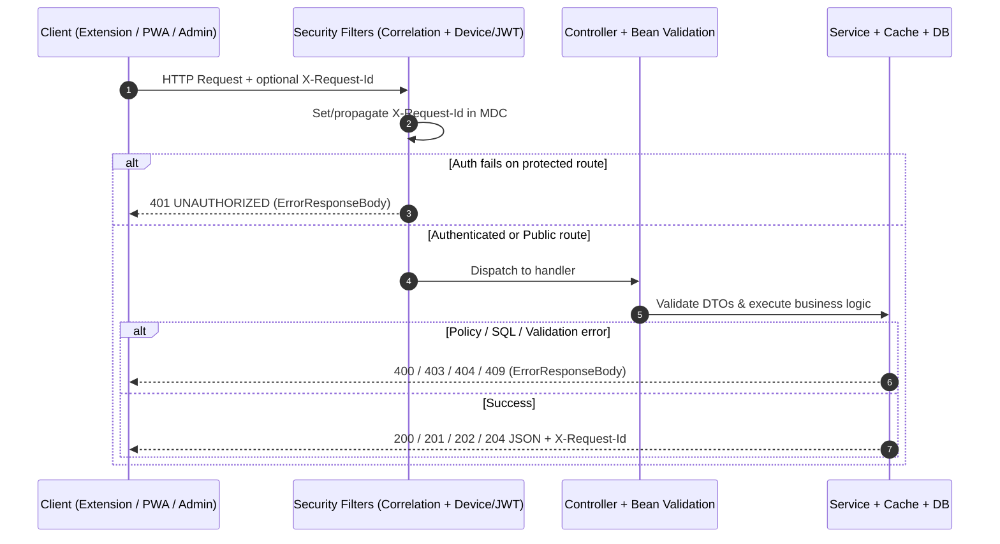

# Criterion: API Documentation

## Architecture Decision Record


### Context

AutoOffer connects three independent client/server surfaces—a Chrome MV3 Extension, a Vue 3 PWA, and a Spring Boot backend—operated by both anonymous/pseudonymous end-users and registry administrators (**US 9.2**, **US 1.1**, **US 2.1**, **US 2.4**, **US 6.1**, **BA 2.8**). Clear, accurate, machine-validated API documentation is critical because:
- **Dual Security Contracts:** Device endpoints require both `X-Device-Id` and `Authorization: Bearer <token>`, whereas Admin endpoints require an HS256 JWT **without** `X-Device-Id`. Ambiguity here causes immediate integration failures.
- **Privacy & Compliance Guarantees:** Integrators must clearly understand which boards store `url_only` vs `full` text, how PII sanitization behaves, and how anonymous GDPR Art. 17 takedown requests work.
- **Developer Experience & Verification:** Reviewers and contributors need runnable examples, error recovery guidance, architectural diagrams, and automated spec linting to prevent documentation drift.

### Decision

Adopt a **Code-Aligned OpenAPI 3.1.0 + Structured Markdown Docs Hub** workflow under `docs/api/`:
1. **Single Machine-Readable Source of Truth (`docs/api/openapi.yaml`):** Annotated Springdoc controllers + hand-curated OpenAPI 3.1.0 spec including `deviceIdHeader` + `bearerAuth`, discrete `Pageable` parameters (`page`, `size`, `sort`), ClickHouse OLAP response schemas, `ErrorResponseBody` taxonomy, and typical + edge-case examples on endpoints.
2. **Modular Documentation Hierarchy (`docs/api/`):** Organized into `/guides` (`getting-started.md`, `integration-tutorial.md`, `architecture-and-concepts.md`), `/reference` (`endpoints.md`), `/examples` (`autooffer.http`), `/schemas` (`README.md`), `README.md`, and `CHANGELOG.md`.
3. **Automated CI Validation & Rendering:** GitHub Actions (`.github/workflows/ci-cd.yml` `api-docs-lint` job) runs `@redocly/cli lint` against `docs/api/redocly.yaml` and builds a static `redoc.html` artifact on every push/PR; Swagger UI (`/swagger-ui.html`) is available in the `local` Spring profile and disabled in `prod`.

### Alternatives Considered

| Alternative | Pros | Cons | Why Not Chosen |
| :--- | :--- | :--- | :--- |
| **OpenAPI 3.1.0 + Modular Markdown + Redocly CI (Chosen)** | Version-controlled in Git, machine-linted in CI, renders via Swagger UI & Redoc, supports tutorials/diagrams/HTTP examples alongside spec | Requires keeping `openapi.yaml` synced when controllers change | Best DX, zero external SaaS lock-in, and full compliance with diploma standards |
| **Swagger UI runtime generation only (no curated guides/examples)** | Zero manual maintenance | No conceptual guides, sequence diagrams, tutorials, changelog, or edge-case walkthroughs; disabled in `prod` | Fails developer experience, architecture overview, and minimum guide/tutorial criteria |
| **External SaaS Docs (Postman Cloud / Stoplight SaaS / GitBook)** | Rich hosted UI | External dependency, potential paywalls, drift from repository version control | Violates no-paid-tools & self-contained repository reproducibility constraints |

### Consequences

- **Positive:**
  - Every endpoint, header (`X-Device-Id` vs Admin JWT), status code (`200`/`201`/`202`/`204`/`4xx`), and error code is documented with runnable `curl`/`HTTP`/`JS` examples.
  - Redocly CLI linting in CI catches broken `$ref`s, missing descriptions, or invalid OpenAPI 3.1 schemas automatically.
  - Prism mock server (`npx @stoplight/prism-cli mock docs/api/openapi.yaml`) enables frontend/extension testing without booting the full backend.
- **Negative:**
  - `docs/api/openapi.yaml` must be updated alongside controller changes (mitigated by CI `api-docs-lint` and `ControllerUnitTests`).
- **Neutral:**
  - Swagger UI is enabled in `local` profile for interactive testing and turned off in `application-prod.yaml` for production attack-surface minimization, while static Redoc HTML is produced in CI.

---

## Documentation Strategy

* **Standards & Tools:** OpenAPI `3.1.0` (`springdoc-openapi-starter-webmvc-ui:2.8.5`), Redocly CLI (`@redocly/cli@1.25.10`) for linting and static HTML generation, Prism (`@stoplight/prism-cli`) for mock sandboxing, and Mermaid for architecture/sequence diagrams.
* **Folder & Naming Conventions:** Consistent lowercase kebab-case structure under `docs/api/` (`/guides`, `/reference`, `/examples`, `/schemas`, `CHANGELOG.md`, `openapi.yaml`, `redocly.yaml`, `README.md`) and ADR report at `docs/02-technical/api.md`.
* **Versioning Approach:** Semantic versioning (`0.1.0`) tracked in `openapi.yaml` `info.version` and `docs/api/CHANGELOG.md`; breaking path changes require `/api/v2/...` prefixing and deprecation notices.
* **Formatting Rules:** Every endpoint documents HTTP method, path, auth scheme, parameters, request/response schemas, typical & edge-case examples, and `ErrorResponseBody` codes.

---

## Implementation Details

### Documentation Structure

```text
docs/
├── 02-technical/
│   └── api.md                                    # API Documentation ADR, strategy & checklist
└── api/
    ├── README.md                                 # Hub & navigation table
    ├── openapi.yaml                              # OpenAPI 3.1.0 spec (27 operations, examples, ErrorResponseBody)
    ├── redocly.yaml                              # Redocly CLI lint ruleset
    ├── CHANGELOG.md                              # Versioning policy & release history
    ├── guides/
    │   ├── getting-started.md                    # Prerequisites, base URLs, health check, auth overview, tools
    │   ├── integration-tutorial.md               # 3 step-by-step E2E tutorials (curl + JS fetch)
    │   └── architecture-and-concepts.md          # Diagrams, auth deep dive, pagination, idempotency, caching, error taxonomy
    ├── reference/
    │   └── endpoints.md                          # Complete endpoint catalog & typical/edge-case examples
    ├── examples/
    │   └── autooffer.http                        # Runnable REST Client collection
    └── schemas/
        └── README.md                             # Data models, constraints & frontend types.js mapping
```

### Request Lifecycle Diagram



---

## Requirements Checklist

### Minimum API Documentation Requirements

| # | Requirement | Status | Evidence / Notes |
| :- | :--- | :-: | :--- |
| 1 | Structured, organized API reference (endpoints, params, auth, errors) | ✅ | `docs/api/README.md`, `docs/api/reference/endpoints.md`, `docs/api/schemas/README.md`. |
| 2 | Industry-standard, validated, version-controlled API spec | ✅ | OpenAPI 3.1.0 in `docs/api/openapi.yaml`, validated by Redocly CLI (`docs/api/redocly.yaml`) in `.github/workflows/ci-cd.yml`. |
| 3 | Meaningful examples (requests, responses, status codes, errors, models) | ✅ | Examples embedded in `docs/api/openapi.yaml`, `docs/api/reference/endpoints.md`, and `docs/api/examples/autooffer.http` (happy paths + edge cases). |
| 4 | Getting Started guide + step-by-step integration tutorial | ✅ | `docs/api/guides/getting-started.md` and `docs/api/guides/integration-tutorial.md` (3 E2E workflows). |
| 5 | High-level architecture overview & diagrams | ✅ | `docs/api/guides/architecture-and-concepts.md` (system context, module map, sequence diagrams). |
| 6 | Developer-accessible published/prepared format | ✅ | Structured Markdown docs + Swagger UI (`local`) + Redoc static HTML build (`redoc.html` CI artifact). |
| 7 | Written documentation strategy & limitations | ✅ | Documented in this ADR (`docs/02-technical/api.md`). |
| 8 | Consistent folder & naming conventions (`/reference`, `/guides`, `/examples`, `/schemas`) | ✅ | Implemented directly under `docs/api/`. |

### Maximum API Documentation Requirements

| # | Requirement | Status | Evidence / Notes |
| :- | :--- | :-: | :--- |
| 9 | Comprehensive DX docs (conceptual guides, onboarding, release notes, versioning) | ✅ | `docs/api/guides/`, `docs/api/CHANGELOG.md`, `docs/api/README.md`. |
| 10 | Advanced topics (flows, pagination, rate limits, auth deep dive, error taxonomy, idempotency, versioning) | ✅ | Covered thoroughly in `docs/api/guides/architecture-and-concepts.md`. |
| 11 | Detailed diagrams (sequence, component, request-response lifecycle) | ✅ | Mermaid diagrams in `docs/api/guides/architecture-and-concepts.md` and `docs/02-technical/api.md`. |
| 12 | Advanced tooling (API linting, mock server instructions, auto-built Redoc) | ✅ | Redocly CLI lint + static Redoc build in `.github/workflows/ci-cd.yml`; Prism mock server documented in `getting-started.md`. |
| 13 | Contract testing (e.g., Pact) / public hosted docs URL | ⚠️ | Backend tests verify endpoints and schemas, and Redoc HTML is built in CI, but Pact consumer-driven contracts and a hosted GitHub Pages Redoc deployment are not yet wired. |

Legend: ✅ Fully implemented · ⚠️ Partially implemented · ❌ Not implemented

---

## Known Limitations

| Limitation | Impact | Potential Solution |
| :--- | :--- | :--- |
| **No Hosted Static Redoc Site on GitHub Pages Yet** | CI builds `redoc.html` as a workflow artifact rather than publishing it to a public URL (`docs` branch / Pages) alongside the PWA. | Add a GitHub Pages deploy step for `docs/api/redoc.html` under `/AutoOffer/api/` or similar path. |
| **No Consumer-Driven Pact Contracts** | OpenAPI schema drift is caught by Redocly lint and integration tests, not formal Pact broker verification between Extension/PWA and Spring Boot. | Add Pact JS tests in `src/client/pwa` and Pact JVM provider verification in `src/server/AutoOffer`. |
| **No Server-Side HTTP `429` Rate Limiter** | Rate-limit guidance relies on client throttling (`1.5–3.5 s`) and reverse-proxy configuration. | Configure Nginx/Caddy `limit_req` or Bucket4j and document `429 Too Many Requests` + `Retry-After` headers. |

---

## References

- `docs/api/README.md`
- `docs/api/openapi.yaml`
- `docs/api/redocly.yaml`
- `docs/api/CHANGELOG.md`
- `docs/api/guides/getting-started.md`
- `docs/api/guides/integration-tutorial.md`
- `docs/api/guides/architecture-and-concepts.md`
- `docs/api/reference/endpoints.md`
- `docs/api/examples/autooffer.http`
- `docs/api/schemas/README.md`
- `.github/workflows/ci-cd.yml`
- [OpenAPI 3.1.0 Specification](https://spec.openapis.org/oas/v3.1.0)
- [Redocly CLI Documentation](https://redocly.com/docs/cli/)
- [Stoplight Prism Mock Server](https://docs.stoplight.io/docs/prism)
