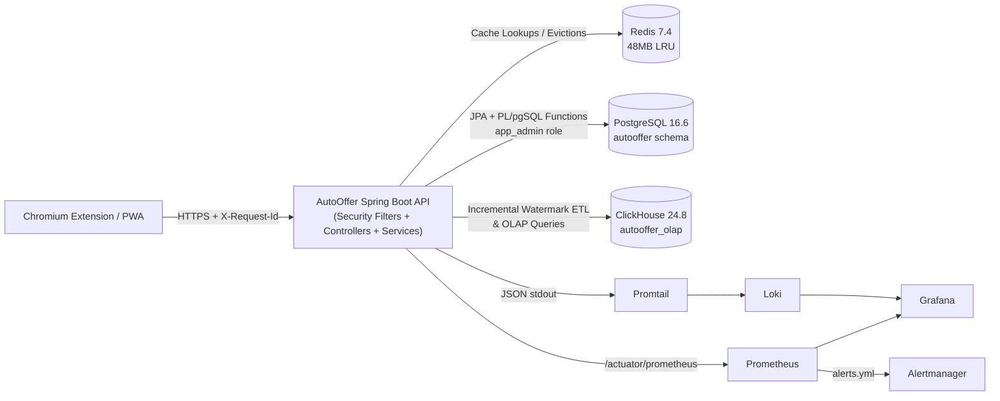

# Criterion: Backend

## Architecture Decision Record


### Context

AutoOffer accelerates job applications while guaranteeing strict client-side privacy (**G1–G5**, **NFR 1–6**, **US 1.1–9.2**):
- **Privacy & GDPR (Art. 5, 6, 17, 25; KPI 2 / NFR 3):** Zero resumes, candidate profiles, or platform credentials may ever reach or be stored on the central server. Clients onboard anonymously via a random `pseudonymous_id` (**US 7.1**), recruiter PII (emails, phones, personal names) is stripped before storage (**US 1.3**), and anonymous GDPR Art. 17 removal requests must be supported (**BA 2.8**).
- **Board Terms & EU Database Right (Directive 96/9/EC Art. 7; R7):** Automated scraping and full-text vacancy storage are allowed **only** on job boards with `permission_status = 'granted'` in the central whitelist (`indeed.com`, `ziprecruiter.com`, `weworkremotely.com` default to `'none'`). Unpermitted boards store `url_only` records, and revoking permission must immediately purge stored full text.
- **Dynamic Selector Distribution (G3, NFR 2, R4):** Declarative CSS/XPath selectors must be served quickly (`p95 < 200 ms`), validated to reject scripts/URLs, and released only after administrator review (**US 2.4**).
- **Skill Analytics (G5, US 6.1–6.2):** Aggregated market demand (`mv_skill_hotwords` and ClickHouse OLAP marts) must be queryable without slowing down transactional ingestion.
- **Resource & Operational Constraints:** The entire backend + database + observability stack must run reproducibly via a single container orchestration command (**US 9.1**) with minimal total RAM usage, automated CI/CD quality/security gates, and machine-readable OpenAPI documentation (**US 9.2**).

### Decision

Build a layered **Spring Boot 4.1.2 (Java 26)** backend backed by **PostgreSQL 16.6** (OLTP), **ClickHouse 24.8** (OLAP), and **Redis 7.4** (distributed cache), packaged as non-root Docker containers with Prometheus/Grafana/Loki observability and automated GitHub Actions CI/CD:
- **Layered Separation:** Thin REST controllers delegate to service interfaces (`VacancyService`, `DeviceAuthService`, `RegistryService`, `DictionaryService`, `SelectorService`, `RemovalRequestService`, `AdminModerationService`) and ETL/scheduler components (`VacancyEtlService`, `SkillHotwordsScheduler`), backed by Spring Data JPA repositories/views and parameterized `NamedParameterJdbcTemplate` calls to PostgreSQL PL/pgSQL functions.
- **Dual Stateless Security:** Pseudonymous devices authenticate via `X-Device-Id` + HMAC-SHA-256 bearer token (`DeviceTokenAuthFilter`); administrators authenticate via BCrypt + HS256 JWT (`AdminJwtFilter`).
- **Database-Enforced Least Privilege:** Liquibase migrations run as `DB_MIGRATOR_USER`, while the Spring Boot runtime connects as `DB_APP_USER` inheriting `app_admin -> app_write -> app_read` with column-level `GRANT`s and triggers enforcing `storage_level` and permission-revocation purges.
- **Minimum RAM Footprint:** JVM configured with `-XX:MaxRAMPercentage=70.0 -XX:+UseSerialGC -Xss256k`, HikariCP capped at `8` connections, Redis capped at `48mb` (`allkeys-lru`), and strict `deploy.resources.limits` across all Compose services (~1.7 GB combined ceiling).

### Alternatives Considered

| Alternative | Pros | Cons | Why Not Chosen |
| :--- | :--- | :--- | :--- |
| **Spring Boot Layered Service + Hybrid JPA/JDBC (Chosen)** | Strong typing, Bean Validation, Spring Security filter chain, Liquibase, Actuator/Micrometer, low RAM with SerialGC (~384 MB limit), seamless PL/pgSQL calls | Single deployable unit (not yet split into microservices) | Best balance of strict security/privacy enforcement, OLTP+OLAP integration, and low memory budget |
| **Multi-Microservice Split (4 Spring Boot apps + RabbitMQ/Kafka)** | Independent scaling and deployment per domain, async event bus | ~4x JVM + broker RAM overhead (exceeds low-RAM target), added operational complexity for MVP | Deferred to next architectural phase if horizontal scaling is required |
| **Node.js (Express/Fastify) or Python (FastAPI)** | Fast prototyping, lower idle RAM per process | No built-in Checkstyle/JaCoCo/Hibernate `ddl-auto: validate` parity with existing team stack; weaker compile-time contracts | Java 26 + Spring Boot provides stronger static checks, mature Liquibase/JPA tooling, and enterprise security defaults |
| **In-Memory `ConcurrentMapCacheManager` only** | Zero external dependency | Lost on restart, no per-cache TTLs, not shareable across replicas | Replaced with Redis 7.4 (`48mb` LRU) for production while keeping `ConcurrentMapCacheManager` as `simple` test fallback |

### Consequences

- **Positive:**
  - Server-side database constraints, triggers, and column-level grants make privacy/whitelist violations impossible even if a controller bug occurs.
  - Redis caching with explicit TTLs (`CacheNames`) protects PostgreSQL from repeated whitelist/dictionary/selector reads.
  - Automated CI/CD enforces Checkstyle (`maxWarnings = 0`), unit + real PostgreSQL Testcontainers integration tests, `>= 80%` JaCoCo line coverage, and Trivy vulnerability scans before pushing or deploying images.
  - Low-RAM tuning lets the full stack (app, Postgres, ClickHouse, Redis, Prometheus, Loki, Promtail, Grafana, Alertmanager) run comfortably on modest hosts.
- **Negative:**
  - Because the backend is currently a single Spring Boot application without RabbitMQ/Kafka, it does not yet satisfy the microservices and asynchronous broker criteria of the 10-point maximum rubric.
  - Alertmanager currently points to a placeholder webhook (`http://localhost:9999/alerts`) until a real Telegram/Slack/email receiver is configured.
- **Neutral:**
  - Mixing JPA (for `Admin`, `Device`, and read-only views) with `JdbcTemplate` (for PL/pgSQL functions `upsert_vacancy`, `submit_selector`, `approve_selector`, `reject_selector`, and ClickHouse ETL) keeps complex database logic atomic inside PostgreSQL while preserving ORM schema validation (`ddl-auto: validate`).

---

## Implementation Details

### Project Structure

```text
.github/
└── workflows/
    └── ci-cd.yml                                 # Quality gate (Checkstyle, tests, JaCoCo >= 80%), Trivy scans, GHCR push, SSH deploy
docs/
├── api/
│   └── openapi.yaml                              # OpenAPI 3.1.0 contract (200/201/202/204/4xx, ErrorResponseBody)
├── 02-technical/
│   └── backend.md                                # This ADR & criteria report
└── criteria/
    └── database-dictionary.md                    # OLTP/OLAP/IndexedDB data dictionary
src/server/AutoOffer/
├── Dockerfile                                    # Multi-stage Temurin 26 JDK/JRE non-root build (SerialGC, low RAM)
├── docker-compose.yml                            # App, Postgres, ClickHouse, Redis, Prometheus, Alertmanager, Loki, Promtail, Grafana
├── docker-compose.override.yml                   # Local dev port mappings (5432, 8123, 6379, 5005)
├── build.gradle                                  # Dependencies, Checkstyle (maxWarnings=0), JaCoCo (>= 0.80)
├── config/checkstyle/checkstyle.xml              # Static analysis rules
├── docker/                                       # Postgres role init, ClickHouse OLAP DDL, Prometheus, Alertmanager, Loki, Promtail, Grafana
├── main/
│   ├── java/AutoOffer/
│   │   ├── AutoOfferApplication.java             # Entry point (@EnableScheduling, @EnableCaching)
│   │   ├── configuration/                        # SecurityConfig, SecurityProperties, OpenApiConfiguration, CorrelationIdFilter, CacheConfig, CacheNames
│   │   ├── controller/                           # Public REST controllers (Health, DeviceAuth, Registry, Dictionary, Vacancy, Selector, RemovalRequest)
│   │   │   └── admin/                            # Admin REST controllers (AdminAuth, AdminPlatform, AdminRemoval, AdminSelector, AdminVerify)
│   │   ├── dto/                                  # Request/Response Java records (Serializable where Redis-cached)
│   │   ├── entity/                               # JPA entities (Admin, Device) & immutable views (RegistrySelectorView, VacancyFullView)
│   │   ├── etl/                                  # ClickHouseClient, ClickHouseProperties, VacancyEtlService, AnalyticsController
│   │   ├── exception/                            # GlobalExceptionHandler, ErrorCode, ErrorResponseBody
│   │   ├── repository/                           # Spring Data JPA repositories (incl. targeted @Modifying updatePasswordHash)
│   │   ├── scheduler/                            # SkillHotwordsScheduler (mv_skill_hotwords refresh)
│   │   ├── security/                             # DeviceTokenAuthFilter, AdminJwtFilter, JwtUtils, DevicePrincipal, SecurityConstants
│   │   └── service/                              # Service interfaces + impl/ (Vacancy, DeviceAuth, Registry, Dictionary, Selector, RemovalRequest, AdminModeration)
│   └── resources/
│       ├── application.yaml                      # Main config (Hikari 8/2, Redis, Pageable max-page-size 100, ClickHouse, Actuator)
│       ├── application-local.yaml                # Local Liquibase seed context & debug logging
│       ├── application-prod.yaml                 # Prod JSON stdout logging, Swagger UI disabled
│       ├── logback/                              # local.xml & production.xml (LogstashEncoder JSON)
│       └── db/changelog/                         # Liquibase V1-V6 SQL migrations & least-privilege grants
└── test/
    ├── java/AutoOffer/
    │   ├── AutoOfferApplicationTests.java        # Spring context & core workflow tests
    │   ├── ControllerUnitTests.java              # MockMvc standalone controller & validation tests
    │   ├── GlobalExceptionHandlerTest.java       # Error mapping & PostgreSQL SQLState tests
    │   ├── SecurityAndFiltersTest.java           # JWT, device token, correlation ID, 401/403 security chain tests
    │   ├── ServiceAndEtlUnitTests.java           # Service layer, ClickHouseClient & VacancyEtlService tests
    │   └── PostgresGrantsAndLiquibaseIntegrationTest.java # Testcontainers Postgres 16 + Liquibase + role/column-grant E2E tests
    └── resources/application-test.yaml           # H2 + simple cache config for unit tests
```

### Key Implementation Decisions

| Decision | Rationale |
| :--- | :--- |
| **Targeted `@Modifying @Query` in `AdminRepository.updatePasswordHash`** | `03__roles.sql` restricts `app_admin` to `GRANT UPDATE (password_hash, is_active) ON admins`. Standard JPA `save()` emits `UPDATE` on all columns (`username`, `updated_at`), causing PostgreSQL `42501`. The targeted query updates only `password_hash`, verified via Testcontainers. |
| **Server-enforced PII sanitization & `storage_level`** | `VacancyServiceImpl.sanitizePersonalNames()` strips recruiter names before DB calls; PostgreSQL `sanitize_description()` strips emails/phones; `upsert_vacancy()` and `enforce_vacancy_storage_policy` trigger ensure clients can never force `full` text on non-whitelisted boards. |
| **Redis Caching (`CacheConfig`) + `simple` test fallback** | Externalizes hot read caches (`whitelist`, `dictionariesBootstrap`, `selectors`, `skillHotwords`) to `redis:7.4-alpine` with per-cache TTLs (5–30 min) and `@CacheEvict` on admin mutations, while `@ConditionalOnMissingBean` provides `ConcurrentMapCacheManager` in tests. |
| **Input & Query Hardening** | Bean Validation (`@Valid`, `@Pattern`, `@Size`, `@DecimalMin`), regex rejection of scripts/URLs in `SelectorServiceImpl`, `ILIKE` wildcard escaping (`\`, `%`, `_`) in `DictionaryServiceImpl`, and `spring.data.web.pageable.max-page-size: 100`. |
| **Low-RAM Container & JVM Tuning** | `-XX:+UseSerialGC -Xss256k -XX:MaxRAMPercentage=70.0` in `Dockerfile`, HikariCP `8/2` in `application.yaml`, Postgres `shared_buffers=48MB`, Redis `--maxmemory 48mb`, and explicit `deploy.resources.limits` in `docker-compose.yml`. |
| **Machine-Readable OpenAPI & Centralized Error Model** | Every controller declares `@Operation`, `@ApiResponse`, `@ResponseStatus`, and `produces = application/json`, synchronized with `docs/api/openapi.yaml` and `ErrorResponseBody`. |

### Code Examples

```java
// Targeted column-safe update in AdminRepository.java to respect PostgreSQL GRANT UPDATE (password_hash, is_active)
public interface AdminRepository extends JpaRepository<Admin, UUID> {
    Optional<Admin> findByUsernameAndIsActiveTrue(String username);

    @Modifying
    @Query("UPDATE Admin a SET a.passwordHash = :passwordHash WHERE a.id = :id")
    int updatePasswordHash(@Param("id") UUID id, @Param("passwordHash") String passwordHash);
}
```

```java
// Redis TTL cache configuration with test fallback in CacheConfig.java
@Configuration
public class CacheConfig {
    @Bean
    @ConditionalOnProperty(name = "spring.cache.type", havingValue = "redis")
    public CacheManager redisCacheManager(RedisConnectionFactory connectionFactory) {
        RedisCacheConfiguration defaults = RedisCacheConfiguration.defaultCacheConfig()
                .disableCachingNullValues()
                .entryTtl(Duration.ofMinutes(10));
        Map<String, RedisCacheConfiguration> perCache = Map.of(
                CacheNames.WHITELIST, defaults.entryTtl(Duration.ofMinutes(10)),
                CacheNames.DICTIONARIES_BOOTSTRAP, defaults.entryTtl(Duration.ofMinutes(30)),
                CacheNames.SELECTORS, defaults.entryTtl(Duration.ofMinutes(5)),
                CacheNames.SKILL_HOTWORDS, defaults.entryTtl(Duration.ofMinutes(10))
        );
        return RedisCacheManager.builder(connectionFactory)
                .cacheDefaults(defaults)
                .withInitialCacheConfigurations(perCache)
                .build();
    }

    @Bean
    @ConditionalOnMissingBean(CacheManager.class)
    public CacheManager fallbackCacheManager() {
        return new ConcurrentMapCacheManager(
                CacheNames.WHITELIST, CacheNames.DICTIONARIES_BOOTSTRAP,
                CacheNames.SELECTORS, CacheNames.SKILL_HOTWORDS);
    }
}
```

### Diagrams



---

## Requirements Checklist

### Minimum Backend Requirements

| # | Requirement | Status | Evidence / Notes |
| :- | :--- | :-: | :--- |
| 1 | Modern Framework | ✅ | Spring Boot 4.1.2 (Java 26), Web, Validation, Security, Actuator, Liquibase (`build.gradle`). |
| 2 | Data State Management | ✅ | PostgreSQL 16.6 OLTP + ClickHouse 24.8 OLAP + Redis 7.4 cache (`docker-compose.yml`). |
| 3 | Use an ORM | ✅ | Spring Data JPA / Hibernate (`ddl-auto: validate`) for `Admin`, `Device`, `RegistrySelectorView`, `VacancyFullView`. |
| 4 | Layered Architecture | ✅ | Strict `controller -> service -> repository/JDBC` separation across all public, admin, and ETL flows. |
| 5 | SOLID Design Principles | ✅ | Service interfaces (`VacancyService`, `RegistryService`, `DictionaryService`, `SelectorService`, `RemovalRequestService`, `AdminModerationService`, `DeviceAuthService`), single-responsibility filters/handlers, constructor injection. |
| 6 | API Description | ✅ | Springdoc OpenAPI annotations + synchronized `docs/api/openapi.yaml` (`200`/`201`/`202`/`204`/`4xx`, `ErrorResponseBody`). |
| 7 | Global Error Handling | ✅ | `GlobalExceptionHandler` (`@RestControllerAdvice`) + `SecurityConfig` JSON 401/403 handlers. |
| 8 | Structured Logging | ✅ | `logback/production.xml` (`LogstashEncoder` JSON) + `CorrelationIdFilter` MDC `requestId`. |
| 9 | Production Deployment | ⚠️ | Multi-stage non-root `Dockerfile`, low-RAM `docker-compose.yml`, and SSH CD workflow implemented; live externally accessible deployment URL must be demonstrated at defense. |
| 10 | Test Coverage (`>= 70%`) | ✅ | Confirmed passing via `./gradlew check`: **88.73% LINE coverage** (606/683) and **72.07% BRANCH coverage** (129/179) against the JaCoCo `0.80` gate, covering unit tests + `PostgresGrantsAndLiquibaseIntegrationTest` (Testcontainers). |
| 11 | Constraints (JSON, No Hardcoded Secrets, Git, No Stubs, Security) | ✅ | JSON DTOs, `.env` env-var injection, BCrypt + HMAC-SHA-256 + JJWT, Bean Validation + PostgreSQL `CHECK`s. |

### Maximum Backend Requirements (10-Point Tier)

| # | Requirement | Status | Evidence / Notes |
| :- | :--- | :-: | :--- |
| 12 | CI/CD Practices | ✅ | `.github/workflows/ci-cd.yml` runs build, test, Trivy scans, GHCR push, and SSH/Compose deployment on `main`. |
| 13 | Quality Gates in CI/CD | ✅ | Checkstyle (`maxWarnings = 0`), unit + Testcontainers tests, JaCoCo `>= 80%`, and Trivy `CRITICAL,HIGH` scans gate push/deploy. |
| 14 | Caching | ✅ | Redis 7.4 (`spring-boot-starter-data-redis` + `CacheConfig` per-cache TTLs + `@CacheEvict`). |
| 15 | System Monitoring | ✅ | `/actuator/prometheus` + Prometheus + Grafana dashboard (`autooffer-overview.json`). |
| 16 | Log Management System | ✅ | `LogstashEncoder` JSON stdout -> Promtail -> Loki -> Grafana. |
| 17 | Request Tracing Between Microservices | ⚠️ | `X-Request-Id` correlation propagates across `CorrelationIdFilter` and `ClickHouseClient`, but within a single service (no inter-microservice hops yet). |
| 18 | Alerting System | ⚠️ | `alerts.yml` (4 rules) + Alertmanager container deployed; `alertmanager.yml` uses placeholder `http://localhost:9999/alerts` until Slack/Telegram/email is configured. |
| 19 | Microservice Architecture | ❌ | Backend runs as a single Spring Boot application (`AutoOfferApplication`) rather than independently deployable microservices. |
| 20 | Asynchronous Communication | ❌ | No message broker (RabbitMQ/Kafka); `VacancyEtlService` runs via `@Scheduled`. |

Legend: ✅ Fully implemented · ⚠️ Partially implemented / needs verification · ❌ Not implemented

---

## Known Limitations

| Limitation | Impact | Potential Solution |
| :--- | :--- | :--- |
| **Monolithic Backend & No Async Broker** | Does not yet meet the Microservice Architecture and Asynchronous Communication criteria of the 10-point maximum tier. | Extract `registry-service`, `ingestion-service`, `admin-moderation-service`, and `analytics-etl-service` communicating via RabbitMQ/Kafka with `X-Request-Id` propagated across HTTP and message headers. |
| **Alertmanager Placeholder Webhook** | Alerts in `alerts.yml` fire inside Alertmanager (`http://localhost:9999/alerts`) without reaching an external channel. | Configure a Telegram bot, Slack webhook, or SMTP receiver in `docker/alertmanager/alertmanager.yml` via environment variables. |
| **ClickHouse `dm_skill_demand` on Vacancy Updates** | `mv_stg_to_skill_demand` appends `+1` on updated rows in `stg_vacancies` (`ReplacingMergeTree`) until a manual mart rebuild runs. | Trigger `rebuildSkillDemandMart()` automatically at the end of ETL batches containing updates or replace the MV with a scheduled rebuild / deduplicated query. |
| **No Reverse Proxy / TLS in `docker-compose.yml`** | App listens on plain HTTP (`:8080`); production external users require HTTPS. | Front `app` with Nginx/Caddy/Traefik and Let's Encrypt TLS termination on the deployment host. |
| **Static FX Rates in `VacancyEtlService`** | `FX_TO_EUR` uses hardcoded constants (`USD`, `GBP`, `PLN`). | Load exchange rates from configuration or an external FX rate table/API. |

---

## References

- **Repository API & Database Docs:**
  - `docs/api/openapi.yaml`
  - `docs/criteria/database-dictionary.md`
  - `.github/workflows/ci-cd.yml`
  - `src/server/AutoOffer/build.gradle`
  - `src/server/AutoOffer/docker-compose.yml`
  - `src/server/AutoOffer/main/resources/db/changelog/`
- **External Documentation:**
  - [Spring Boot Documentation](https://docs.spring.io/spring-boot/index.html)
  - [Spring Data Redis Caching](https://docs.spring.io/spring-data/redis/reference/redis/redis-cache.html)
  - [Liquibase Documentation](https://docs.liquibase.com/)
  - [PostgreSQL 16 Privileges & PL/pgSQL](https://www.postgresql.org/docs/16/ddl-priv.html)
  - [ClickHouse ReplacingMergeTree & SummingMergeTree](https://clickhouse.com/docs/en/engines/table-engines/mergetree-family/replacingmergetree)
  - [Testcontainers for Java](https://java.testcontainers.org/)
  - [OpenAPI 3.1.0 Specification](https://spec.openapis.org/oas/v3.1.0)
  - [Prometheus, Alertmanager, Loki & Grafana](https://grafana.com/docs/)
