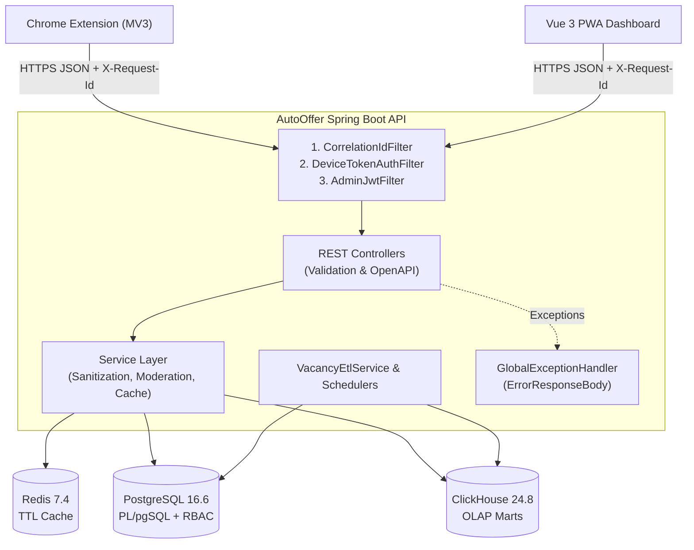
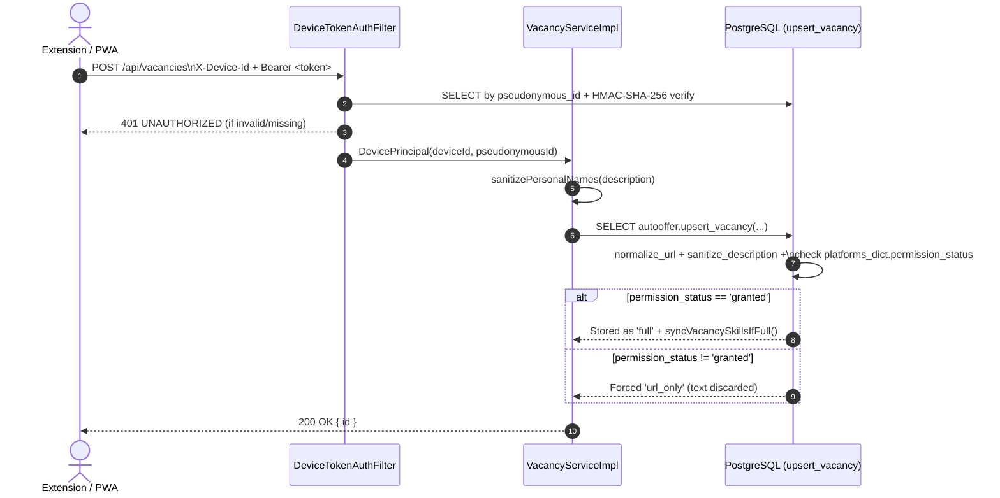
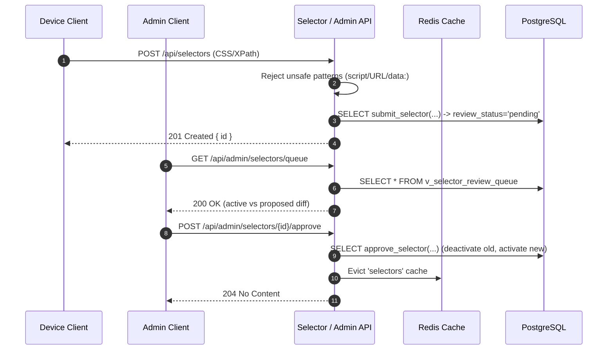

# API Architecture & Design Concepts

## 1. System Context & Request Flow



### Module Responsibilities

| Module | Package | Responsibility |
| :--- | :--- | :--- |
| **Security & Correlation** | `AutoOffer.security`, `AutoOffer.configuration` | Assigns `X-Request-Id` (`CorrelationIdFilter`), validates device HMAC tokens (`DeviceTokenAuthFilter`) and admin JWTs (`AdminJwtFilter`). |
| **Public Ingestion & Registry** | `AutoOffer.controller`, `AutoOffer.service.impl` | Serves cached whitelist/dictionaries/selectors (`RegistryService`, `DictionaryService`), sanitizes & deduplicates vacancies (`VacancyService`), validates selectors (`SelectorService`), accepts Art. 17 takedowns (`RemovalRequestService`). |
| **Admin Moderation** | `AutoOffer.controller.admin`, `AdminModerationServiceImpl` | Platform permissions (with full-text purge trigger), selector review queue, GDPR removal execution, dictionary/vacancy verification, admin password rotation. |
| **OLAP Analytics & ETL** | `AutoOffer.etl`, `AutoOffer.scheduler` | Incremental watermark Postgres-to-ClickHouse sync (`VacancyEtlService`), OLAP queries (`AnalyticsController`), materialized view refresh (`SkillHotwordsScheduler`). |

---

## 2. Sequence Diagrams

### Device Auth & Policy-Enforced Vacancy Upsert



### Selector Review & Cache Eviction Lifecycle



---

## 3. Authentication & Authorization Deep Dive

1. **Device Authentication (`ROLE_DEVICE`):**
   - Triggered **only** when both `X-Device-Id: <uuid>` and `Authorization: Bearer <token>` are present.
   - Server computes `HMAC-SHA-256(pepper, rawToken)` and compares against `devices.auth_token_hash` using constant-time `MessageDigest.isEqual`.
   - Updates `devices.last_active_at`.
2. **Administrator Authentication (`ROLE_ADMIN`):**
   - `AdminJwtFilter` runs **only** when `X-Device-Id` is absent (`req.getHeader("X-Device-Id") == null`).
   - Validates HS256 JWT signature and `role = ROLE_ADMIN` claim (`JwtUtils`).
   - Never send `X-Device-Id` on `/api/admin/**` requests, or `AdminJwtFilter` will skip JWT extraction.
3. **Database-Layer Enforcement:**
   - Runtime DB role `DB_APP_USER` is never a PostgreSQL superuser; `app_admin -> app_write -> app_read` column-level grants block unprivileged writes even below the JVM layer.

---

## 4. Pagination, Incremental Sync & Caching

* **Pagination (`GET /api/vacancies`):** Uses Spring Data `Pageable` with `page=0`, `size=20` default, **`max-page-size=100`** (`application.yaml`), and `sort=updatedAt,desc`.
* **Incremental Polling (`GET /api/registry/selectors?since=...`):** Clients pass the last seen `updatedAt` timestamp to retrieve only newly approved selectors; unfiltered calls hit Redis (`5m` TTL).
* **Redis Caching (`CacheConfig`):**
  * `whitelist`: `10m` TTL (evicted on `PATCH /api/admin/platforms/{id}/permission`)
  * `dictionariesBootstrap`: `30m` TTL (evicted on permission update, position/skill verify)
  * `selectors`: `5m` TTL (evicted on selector approve/reject)
  * `skillHotwords`: `10m` TTL (evicted on `SkillHotwordsScheduler` & position/skill verify)

---

## 5. Idempotency & Deduplication

| Endpoint | Idempotency Mechanism |
| :--- | :--- |
| `POST /api/devices/register` | Idempotent per `pseudonymousId`: `ON CONFLICT (pseudonymous_id) DO UPDATE` rotates `auth_token_hash` cleanly without creating duplicate device rows. |
| `POST /api/vacancies` | Deduplicates by normalized `url` and `dedup_hash = sha256(lower(platform|company|normalized_url))`; repeated calls increment `submission_count` and merge non-null fields forward-only without erasing `full` content. |
| `POST /api/admin/etl/run` | Uses `autooffer.etl_watermark` (`last_synced_at`) and ClickHouse `ReplacingMergeTree(updated_at)` so re-runs are safe. |

---

## 6. Rate Limiting & Abuse Prevention

* **Client-Side Board Throttling:** Per project contract (BA R2/R7), automated extension requests enforce `1.5–3.5 s` randomized delays and configurable page limits on permitted boards.
* **Server-Side Input Bounds:** Request sizes are bounded (`url <= 2048`, `selectorString <= 2000`, `page size <= 100`, `searchSkills` `LIMIT 20`, `hotwords` `LIMIT 50`, `q` wildcards escaped).
* **Gateway Recommendation:** Because the Spring Boot app does not embed an in-process HTTP rate limiter (no `429 Too Many Requests` handler), production deployments should enforce `limit_req` at the Nginx/Caddy reverse proxy.

---

## 7. Error Taxonomy & Recovery

All errors (validation, security 401/403, business conflicts, and PostgreSQL constraint errors) return `ErrorResponseBody`:

```json
{
  "timestamp": "2026-11-16T10:15:30Z",
  "status": 400,
  "code": "VALIDATION_ERROR",
  "message": "Request validation failed",
  "details": {
    "url": "Must be http(s) URL"
  }
}
```

| `code` | HTTP | Typical Cause | Client Recovery Action |
| :--- | :--- | :--- | :--- |
| `VALIDATION_ERROR` | `400` | Missing/invalid DTO field, invalid UUID, bad status query | Fix fields listed in `details` and resend. |
| `DB_POLICY_VIOLATION` | `400` | Unsafe selector (`javascript:`), `salaryFrom > salaryTo`, or `CHECK`/`FK` SQL violation | Inspect `message`; drop invalid location/salary combination or unsafe string. |
| `UNAUTHORIZED` | `401` | Missing/expired JWT or invalid `X-Device-Id` / token pair | Re-authenticate via `/api/admin/auth/login` or rotate token via `/api/devices/register`. |
| `FORBIDDEN` | `403` | Device token used on `/api/admin/**`, inactive admin, or DB `42501` | Use proper role credentials; do not retry with same role. |
| `RESOURCE_NOT_FOUND` | `404` | Non-existent UUID on admin moderation/verification | Refresh queue/list and verify target ID. |
| `CONFLICT` | `409` | Removal request already processed or PostgreSQL `23505` unique conflict | Reload current resource state; do not retry blindly. |
| `INTERNAL_ERROR` | `500` | Unexpected server or ClickHouse connectivity failure | Retry with exponential backoff; report `X-Request-Id` response header in logs. |
