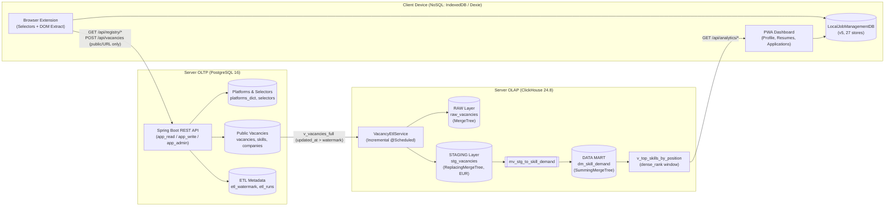

# AutoOffer Database Architecture & Logical Diagrams

_Auto-generated from files on disk on 2026-11-16._

## 1. Multi-DBMS Architecture & OLAP Data Flow



## 2. PostgreSQL OLTP Logical Schema (ER Diagram)

```mermaid
erDiagram
    devices {
        uuid id PK
        uuid pseudonymous_id
        char_64 auth_token_hash
        timestamptz created_at
        timestamptz last_active_at
    }
    admins {
        uuid id PK
        varchar_100 username
        text password_hash
        boolean is_active
        timestamptz created_at
        timestamptz updated_at
    }
    platforms_dict {
        uuid id PK
        varchar_100 name
        varchar_50 code
        varchar_255 url
        varchar_10 permission_status
        timestamptz permission_granted_at
        text permission_reference
        uuid proposed_by_device_id FK
        uuid approved_by_admin_id FK
        timestamptz created_at
        timestamptz updated_at
    }
    selector_tasks_dict {
        uuid id PK
        varchar_50 code
        varchar_100 name
    }
    selector_element_types_dict {
        uuid id PK
        varchar_50 code
        varchar_100 name
    }
    currencies_dict {
        uuid id PK
        char_3 code
        varchar_50 name
    }
    regions_dict {
        uuid id PK
        varchar_50 code
        varchar_100 name
    }
    countries_dict {
        uuid id PK
        uuid region_id FK
        varchar_100 name
    }
    cities_dict {
        uuid id PK
        uuid country_id FK
        varchar_100 name
    }
    levels_dict {
        uuid id PK
        varchar_50 name
    }
    work_formats_dict {
        uuid id PK
        varchar_50 name
    }
    employment_types_dict {
        uuid id PK
        varchar_50 name
    }
    companies_dict {
        uuid id PK
        varchar_255 name
        text website
        boolean is_verified
        uuid created_by_device_id FK
        uuid updated_by_device_id FK
        uuid verified_by_admin_id FK
        timestamptz created_at
        timestamptz updated_at
    }
    positions_dict {
        uuid id PK
        varchar_255 name
        boolean is_verified
        uuid created_by_device_id FK
        uuid updated_by_device_id FK
        uuid verified_by_admin_id FK
        timestamptz created_at
        timestamptz updated_at
    }
    skills {
        uuid id PK
        varchar_100 name
        boolean is_verified
        uuid created_by_device_id FK
        uuid updated_by_device_id FK
        uuid verified_by_admin_id FK
        timestamptz created_at
        timestamptz updated_at
    }
    vacancies {
        uuid id PK
        uuid platform_id FK
        text url
        char_64 dedup_hash
        varchar_8 storage_level
        uuid position_id FK
        varchar_255 full_position_name
        uuid company_id FK
        text address
        uuid region_id FK
        uuid country_id FK
        uuid city_id FK
        numeric_10_2 salary_from
        numeric_10_2 salary_to
        uuid currency_id FK
        uuid level_id FK
        uuid work_format_id FK
        uuid employment_type_id FK
        integer submission_count
        text description
        boolean is_active
        boolean is_verified
        uuid created_by_device_id FK
        uuid updated_by_device_id FK
        uuid verified_by_admin_id FK
        timestamptz created_at
        timestamptz updated_at
    }
    vacancy_skills {
        uuid vacancy_id FK
        uuid skill_id FK
    }
    selectors {
        uuid id PK
        uuid platform_id FK
        uuid task_id FK
        uuid element_type_id FK
        varchar_255 url_pattern
        varchar_5 selector_kind
        text selector_string
        integer version
        uuid previous_version_id FK
        varchar_8 review_status
        boolean is_active
        uuid submitted_by_device_id FK
        uuid reviewed_by_admin_id FK
        timestamptz reviewed_at
        text review_comment
        timestamptz created_at
        timestamptz updated_at
    }
    removal_requests {
        uuid id PK
        text target_url
        text note
        varchar_8 status
        timestamptz created_at
        timestamptz processed_at
        uuid processed_by_admin_id FK
    }
    etl_watermark {
        varchar_64 pipeline_name PK
        timestamptz last_synced_at
        timestamptz updated_at
    }
    etl_runs {
        uuid id PK
        varchar_64 pipeline_name
        timestamptz started_at
        timestamptz finished_at
        varchar_16 status
        integer rows_extracted
        integer rows_loaded
        integer rows_rejected
        text error_message
    }
    devices ||--o{ platforms_dict : "proposed_by_device_id"
    admins ||--o{ platforms_dict : "approved_by_admin_id"
    regions_dict ||--o{ countries_dict : "region_id"
    countries_dict ||--o{ cities_dict : "country_id"
    devices ||--o{ companies_dict : "created_by_device_id"
    devices ||--o{ companies_dict : "updated_by_device_id"
    admins ||--o{ companies_dict : "verified_by_admin_id"
    devices ||--o{ positions_dict : "created_by_device_id"
    devices ||--o{ positions_dict : "updated_by_device_id"
    admins ||--o{ positions_dict : "verified_by_admin_id"
    devices ||--o{ skills : "created_by_device_id"
    devices ||--o{ skills : "updated_by_device_id"
    admins ||--o{ skills : "verified_by_admin_id"
    platforms_dict ||--o{ vacancies : "platform_id"
    positions_dict ||--o{ vacancies : "position_id"
    companies_dict ||--o{ vacancies : "company_id"
    regions_dict ||--o{ vacancies : "region_id"
    countries_dict ||--o{ vacancies : "country_id"
    cities_dict ||--o{ vacancies : "city_id"
    currencies_dict ||--o{ vacancies : "currency_id"
    levels_dict ||--o{ vacancies : "level_id"
    work_formats_dict ||--o{ vacancies : "work_format_id"
    employment_types_dict ||--o{ vacancies : "employment_type_id"
    devices ||--o{ vacancies : "created_by_device_id"
    devices ||--o{ vacancies : "updated_by_device_id"
    admins ||--o{ vacancies : "verified_by_admin_id"
    vacancies ||--o{ vacancy_skills : "vacancy_id"
    skills ||--o{ vacancy_skills : "skill_id"
    platforms_dict ||--o{ selectors : "platform_id"
    selector_tasks_dict ||--o{ selectors : "task_id"
    selector_element_types_dict ||--o{ selectors : "element_type_id"
    selectors ||--o{ selectors : "previous_version_id"
    devices ||--o{ selectors : "submitted_by_device_id"
    admins ||--o{ selectors : "reviewed_by_admin_id"
    admins ||--o{ removal_requests : "processed_by_admin_id"
```



## 3. Client NoSQL Logical Model (IndexedDB / Dexie v5)

```mermaid
erDiagram
    local_device_state {
        string id PK
    }
    platforms_dict {
        string id PK
        index code
        index url
        index name
        index mode
    }
    selector_tasks_dict {
        string id PK
        index code
    }
    selector_element_types_dict {
        string id PK
        index code
    }
    currencies_dict {
        string id PK
        index code
    }
    companies_dict {
        string id PK
        index name
        index is_verified
    }
    positions_dict {
        string id PK
        index name
        index is_verified
    }
    regions_dict {
        string id PK
        index code
    }
    countries_dict {
        string id PK
        index region_id
    }
    cities_dict {
        string id PK
        index country_id
    }
    levels_dict {
        string id PK
    }
    work_formats_dict {
        string id PK
    }
    employment_types_dict {
        string id PK
    }
    selectors {
        string id PK
        index platform_id
        index task_id
        index element_type_id
        index url_pattern
    }
    skills {
        string id PK
        index name
        index is_verified
    }
    local_vacancies {
        string id PK
        index platform_id
        index position_id
        index company_id
        index region_id
        index country_id
        index city_id
        index currency_id
        index level_id
        index work_format_id
        index employment_type_id
        index url
        index synced
    }
    local_vacancy_skills {
        string [vacancy_id+skill_id] PK
        index vacancy_id
        index skill_id
    }
    user_profiles {
        string id PK
        index is_default
    }
    personal_data {
        string id PK
        index profile_id
    }
    resumes {
        string id PK
        index profile_id
    }
    resume_skills {
        string [resume_id+skill_id] PK
        index resume_id
        index skill_id
    }
    cover_letters {
        string id PK
        index profile_id
    }
    cover_letter_skills {
        string [cover_letter_id+skill_id] PK
        index cover_letter_id
        index skill_id
    }
    platform_credentials {
        string id PK
        index platform_id
        index profile_id
    }
    ai_configurations {
        string id PK
    }
    prompt_templates {
        string id PK
        index code
    }
    automation_jobs {
        string id PK
        index title
        index status
        index created_at
    }
    user_profiles ||--o{ personal_data : "profile_id"
    user_profiles ||--o{ resumes : "profile_id"
    local_vacancies ||--o{ cover_letters : "vacancy_id"
    platforms_dict ||--o{ selectors : "platform_id"
    platforms_dict ||--o{ local_vacancies : "platform_id"
```
